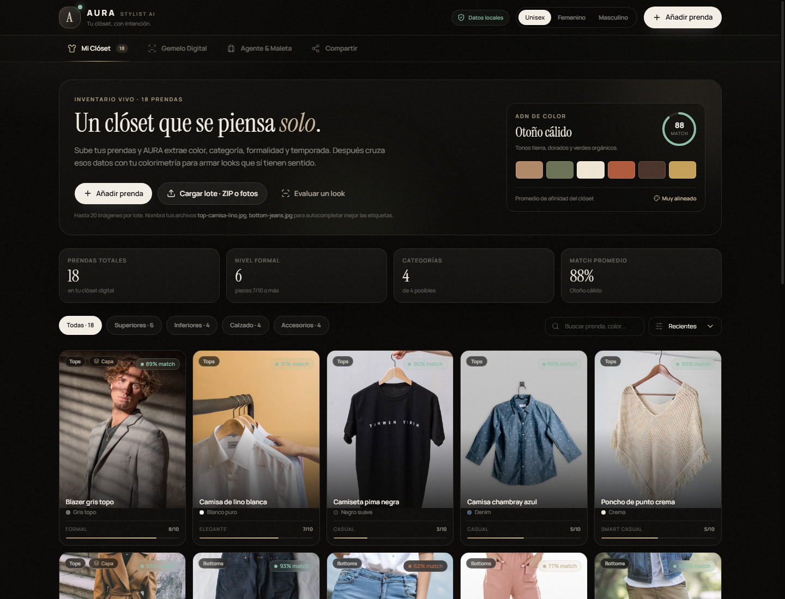

# AURA · Stylist AI

**Tu clóset, con intención.** Un asistente personal de imagen que digitaliza tu clóset, entiende tu colorimetría y arma outfits y maletas cápsula con lo que ya tienes.



## Demo

- **App:** [juandeleon24.github.io/aura-stylist-ai](https://juandeleon24.github.io/aura-stylist-ai/)
- **Modo:** demo local-first con un perfil y un clóset de ejemplo. No requiere cuenta.

## Qué hace

AURA cruza cuatro capas de información —prenda, cuerpo, color y contexto— para responder una pregunta muy concreta: **qué me pongo y qué llevo a la maleta**.

### 1. Clóset digital

- Inventario visual con foto, categoría, subtipo, color, formalidad, temporada, material, abrigo y frecuencia de uso.
- Carga individual o por lote: arrastra fotos o un archivo **ZIP** (hasta 20 imágenes).
- Extracción automática del color dominante y lectura de metadatos desde el nombre del archivo (`top-camisa-lino.jpg`, `bottom-jeans.jpg`…).
- Filtros por categoría, búsqueda y orden por match, formalidad o nombre.
- Edición y eliminación con opción de deshacer.

### 2. Gemelo digital y colorimetría

- Perfil biométrico: estatura, peso, complexión, forma corporal, rostro y tallas.
- Fotos de referencia (frente, perfil, espalda y rostro) comprimidas en el navegador.
- Diagnóstico de subtono, estación, contraste y paleta de poder.
- Colores a evitar cerca del rostro y porcentaje de afinidad del clóset.
- Generación de un **prompt base** para motores de imagen o Virtual Try-On.

### 3. Agente de viaje y maleta

- Formulario de viaje con destino, fechas, días, noches, motivo, clima y notas.
- Interpretación de prompts en lenguaje natural: «Voy a Cartagena por 4 días, cena en la playa y mucha caminata».
- Pronóstico real con **Open-Meteo** cuando la fecha está dentro del rango; referencia estacional cuando no.
- Itinerario día/noche con outfits, score de match, formalidad objetivo y validación de color.
- **Maleta cápsula** con piezas que rotan, lista de básicos, progreso de empaque y equipaje sugerido.
- **Missing piece**: detección de huecos y sugerencias de compra que combinan con 3+ prendas del clóset.
- Exportación del plan a Markdown y prompt de try-on por outfit.

### 4. Compartir y respaldar

- Enlace compartible y resumen de estilo para copiar.
- Respaldo completo en JSON (perfil, fotos, clóset y último plan).
- Importación de respaldo y restauración de la demo.
- Todo se guarda en `localStorage`; no hay cuentas ni servidor propio.

## Cómo funciona el motor

No hay una llamada a un modelo generativo para recomendar: el motor es determinista y auditable.

1. **Elegibilidad:** descarta piezas incompatibles con el clima (por ejemplo, abrigos de invierno en calor extremo o sandalias en frío).
2. **Score por prenda:** combina formalidad, colorimetría, temporada, abrigo, versatilidad y afinidad con el motivo del viaje.
3. **Cápsula:** elige anclas de formalidad baja/alta y completa con las piezas más versátiles.
4. **Outfit:** evalúa combinaciones de superior + inferior + calzado, con penalizaciones por repetición y por falta de coherencia formal.
5. **Validación:** calcula match de color cerca del rostro, promedio del look, formalidad y clima.
6. **Maleta y missing pieces:** agrupa usos, detecta huecos (formal, frío, lluvia, color, accesorios) y ordena compras por compatibilidad.

El clima es la única consulta externa opcional. Si Open-Meteo no responde o la fecha está fuera de los 16 días de pronóstico, AURA usa una referencia estacional y lo indica en el plan.

## Stack

- [React 19](https://react.dev/) + [Vite 6](https://vite.dev/)
- [Tailwind CSS 4](https://tailwindcss.com/) con tema propio
- [lucide-react](https://lucide.dev/) para iconografía
- [JSZip](https://stuk.github.io/jszip/) para carga de lotes (carga diferida)
- `localStorage` + Canvas API para persistencia y procesamiento de imágenes
- GitHub Actions + GitHub Pages para despliegue

## Desarrollo local

Requiere Node.js 20 o superior.

```bash
npm install
npm run dev
```

Abre `http://localhost:5173`.

```bash
npm run build     # build de producción en dist/
npm run preview   # sirve el build localmente
```

## Estructura

```text
src/
  App.jsx                    # estado global, persistencia y navegación
  components/
    Header.jsx               # marca, modo y acción de añadir
    TabNav.jsx               # navegación entre las cuatro áreas
    ClosetTab.jsx            # inventario, filtros y carga por lote/ZIP
    TwinTab.jsx              # biometría, fotos y colorimetría
    AgentTab.jsx             # viaje, itinerario, maleta y shopping
    ShareTab.jsx             # enlace, respaldo, importación y reset
    ItemModal.jsx            # alta/edición de prendas
    EvaluateLookModal.jsx    # evaluación de un look
    ui.jsx                   # modal, toasts, score ring, campos
  lib/
    data.js                  # perfil, inventario demo, eventos y catálogo
    colors.js                # paletas, distancia de color y contraste
    recommendation.js        # motor de cápsula, outfits, maleta y gaps
    prompt.js                # prompts de identidad y try-on
    storage.js               # localStorage, imágenes, ZIP y metadatos
```

## Privacidad

- El perfil, las fotos, las prendas y los planes viven en el navegador.
- No hay backend, cuentas, analítica ni rastreo.
- La única consulta externa es el nombre del destino a Open-Meteo para geocodificación y pronóstico.
- El respaldo JSON es la forma de mover tus datos a otro dispositivo.

> AURA es una demo funcional. No sustituye asesoría de imagen profesional ni garantiza disponibilidad, precios o tallas de los enlaces de compra.

## Despliegue

El workflow [`.github/workflows/deploy.yml`](.github/workflows/deploy.yml) construye y publica `dist/` en GitHub Pages en cada push a `main`.

Para activarlo en un fork:

1. Ve a **Settings → Pages**.
2. En **Build and deployment**, elige **GitHub Actions**.
3. Haz push a `main` o ejecuta el workflow manualmente.

Vite usa `base: './'`, así que el build funciona tanto en la raíz como en un subdirectorio de proyecto (`/aura-stylist-ai/`).

## Roadmap

- [ ] Editor de paleta personalizada y armonías de color.
- [ ] Historial de outfits usados y calendario.
- [ ] Importación de catálogos de tiendas y disponibilidad real.
- [ ] Multiusuario local con perfiles separados.
- [ ] PWA instalable y funcionamiento offline completo.
- [ ] Integración opcional con un modelo de imagen para Virtual Try-On.

## Créditos

- Fotografías de demostración: [Unsplash](https://unsplash.com/).
- Tipografías: Instrument Serif y Manrope (Google Fonts).
- Clima: [Open-Meteo](https://open-meteo.com/).

## Licencia

[MIT](LICENSE) © 2026 JuanDeLeon24
